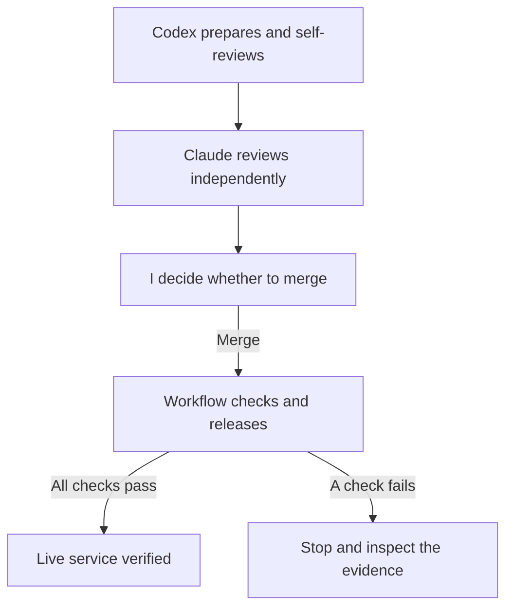

# AI Can Write the Change. Who Controls the Release?

> Unpublished draft. Case-study evidence: 18 October 2026.

The change I used to test my automatic release system was one comment.

It added no feature and changed no behaviour. I wanted to see what happened after I approved a change: would the system release the right version, check that it worked, and leave me something better than “deployment successful”?

The project was [Ask Mantosh](https://mantoshkumar1.github.io/#ask-mantosh), the assistant on this website that helps visitors explore my published work.

## Who gets to say “ship it”?

Codex prepared the change and checked its own work. Claude, a separate AI reviewer, reviewed it independently. I decided whether to merge it.

Two AI agents agreeing gave me another assessment. The decision to put their work into production was still mine. Neither agent had permission to merge or deploy.

Once I merged this qualifying change, GitHub Actions took over. Here is the division of work:

*The AI roles describe our working process. The workflow checks the source and release; it cannot judge how thoughtful a review was. A failure after deployment can leave production changed.*

That last distinction matters. I can ask AI to do more of the work without giving it every decision along the way.

## “Deployed” was only half the answer

Before releasing anything, the system needed to know where the previous attempt had left production.

It reads the latest matching release record and requires that record to show success. If the latest attempt failed, it stops until I reconcile the failure. It does not search backward for a more convenient green result.

It also checks that production still matches that record, and that the source about to be released is the source I approved. If either has changed, the release stops.

After deployment, it looks again. Is the expected version actually serving traffic? Does the service respond? Can it answer a public-profile question and finish a streaming response?

The [test run succeeded](https://github.com/mantoshkumar1/mantoshkumar1.github.io/actions/runs/39169924619). Its [release record](https://github.com/mantoshkumar1/mantoshkumar1.github.io/issues/77#issuecomment-6255657485) tied the approved source to the observed version and those checks.

That record tells me what happened during this release. It does not promise that every answer is correct or that the service will stay healthy tomorrow. The test also said nothing about recovery or private access settings. Those need their own evidence.

## What I wanted from the automation

I wanted to stop repeating deployment steps by hand while keeping the decision to ship.

The one-comment test gave me evidence that this arrangement worked from approval through the live service. The useful part was being able to follow the whole change: who prepared it, who reviewed it, who approved it, and what happened afterward.

If you are letting AI do more of your engineering work, that is a good question to start with: **when it says “done,” what would you need to see before you believe it?**

[Try Ask Mantosh](https://mantoshkumar1.github.io/#ask-mantosh), or see the [release runbook](https://github.com/mantoshkumar1/mantoshkumar1.github.io/blob/e506385c9fa08d11f19d73cfb697ab9782331545/chat-worker/docs/DEPLOYMENT.md) for the implementation.
