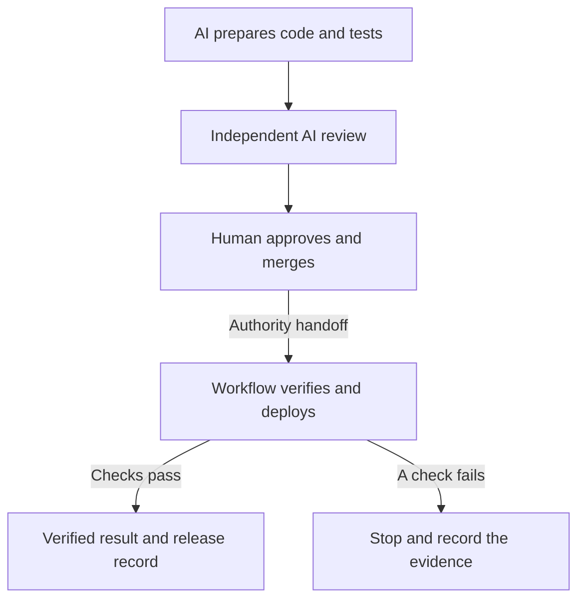

# AI Can Write the Change. Who Controls the Release?

*Let AI build. Keep production behind a boundary.*

> Unpublished draft.

AI coding agents can write code, build tests and review one another's work. That makes them useful engineering tools. It does not make them reliable production operators.

Their behaviour is nondeterministic. An agent can misinterpret a request, act beyond its scope, or describe an action differently from what it actually did. A confident explanation is insufficient grounds for granting production access.

The engineering response is to bound their authority. AI can prepare a change and inspect permitted evidence. Direct production writes, deployment commands and production-pipeline dispatches should stay outside its reach. That boundary belongs in access controls and tooling, beyond the instructions in a prompt.

## Put the human at the handoff

Keeping AI away from production does not require a person to run every deployment step.

The human belongs at the point where the agent's authority ends. The agent submits its finished change, test results and independent review. A person reviews that evidence and decides whether to authorize the handoff.

Approval should identify the work being accepted. If the code changes afterward, the previous approval and test results cannot simply follow along.

Once the approved change is merged, a deterministic workflow can take over: check the source, run the required verification, deploy and inspect the result. The agent does not press the production button. The human's authorized merge triggers that workflow.

*AI prepares; the human authorizes; the workflow executes defined checks. A failure after deployment can leave production changed, so stopping must preserve evidence for recovery.*

## What this looks like in Ask Mantosh

[Ask Mantosh](https://mantoshkumar1.github.io/#ask-mantosh), the assistant on this engineering portfolio, uses this division of responsibility.

For its automatic-release test, Codex prepared and self-reviewed the change, Claude reviewed it independently, and Mantosh made the merge decision. Neither agent had merge or deployment authority. The [test change](https://github.com/mantoshkumar1/mantoshkumar1.github.io/pull/106) was deliberately small: one comment, with no application behaviour change.

After the merge, GitHub Actions verified and released that specific source. Before writing, the workflow checked that production matched the latest matching release record. That record had to show success: a failed latest attempt blocked progress until reconciled, rather than being hidden behind an older green result.

After deployment, the workflow checked the observed version, service health, a public-profile answer and a completed streaming response. A final observation confirmed the new version served all traffic.

The [successful run](https://github.com/mantoshkumar1/mantoshkumar1.github.io/actions/runs/39169924619) produced [a release record](https://github.com/mantoshkumar1/mantoshkumar1.github.io/issues/77#issuecomment-6255657485) tying the source, deployed version and checks together. That record supports both the next release decision and a later audit.

## Automate the work after authorization

The reusable pattern is a controlled handoff: AI delivers a reviewable change; a human authorizes it; a predictable system executes the release and records what happened.

Deterministic automation can still contain bugs. Human approval can still miss defects. The value of this design is that each has a defined responsibility, and the evidence can be inspected when something goes wrong.

The Ask Mantosh test demonstrated one complete release. It did not prove every answer, recovery scenario or private access setting. The release record describes what was observed then, rather than promising future reliability.

**Give AI room to do the engineering work. Give production a boundary the AI cannot authorize itself to cross.**

[Try Ask Mantosh](https://mantoshkumar1.github.io/#ask-mantosh) or read the [release runbook](https://github.com/mantoshkumar1/mantoshkumar1.github.io/blob/e506385c9fa08d11f19d73cfb697ab9782331545/chat-worker/docs/DEPLOYMENT.md).

## Related reading

- [Your Agent’s Tests Are the Cheapest Check You Have](https://mantoshkumar1.github.io/insights/tests-are-the-cheapest-check.html) — why passing tests should be one layer of evidence.
- [Release Reports as Operational History](https://mantoshkumar1.github.io/insights/release-reports-as-operational-history.html) — how release records become useful beyond a single deployment.
