# AI Can Write the Change. Who Controls the Release?

*The gap between “tests passed” and “the right change is live.”*

> Unpublished draft. Case-study evidence: 18 October 2026.

Passing tests leave several release questions unanswered. Who approved the change? Was the tested version the one deployed? Did the service actually work afterward?

AI makes those questions harder to ignore. An agent can produce a convincing explanation alongside working code. A second agent can agree with it. Neither answer establishes what is running in production.

The automatic release path for [Ask Mantosh](https://mantoshkumar1.github.io/#ask-mantosh), a portfolio assistant, makes those questions concrete.

## One comment, a complete release

On 18 October, [a single comment](https://github.com/mantoshkumar1/mantoshkumar1.github.io/pull/106) was added to the assistant's backend code. It changed no application behaviour. Its purpose was to exercise the real release path without introducing a new feature at the same time.

Codex prepared and self-reviewed the change. Claude provided independent AI review. Mantosh made the merge decision; neither agent had authority to merge or deploy. That merge authorized this qualifying backend change to continue through GitHub Actions.

```mermaid
flowchart TD
  A["Codex prepares and self-reviews"] --> B["Claude reviews independently"]
  B --> C["Mantosh decides whether to merge"]
  C -->|"Merge"| D["Workflow checks and releases"]
  D -->|"All checks pass"| E["Live service verified"]
  D -->|"A check fails"| F["Stop and inspect the evidence"]
```

*The roles describe the working process. The workflow checks source and release facts; it cannot judge review quality. A failure after deployment can leave production changed; nothing rolls back automatically.*

This separates three responsibilities: proposing a change, authorizing it, and establishing what happened. More AI assistance does not require collapsing them into one actor.

## Where a green result can mislead

The first gap is between testing and deployment. A check can pass, then the branch can move. Releasing whatever happens to be there would break the connection between the evidence and the change.

This workflow carries one source revision through testing and release, then checks it against current main immediately before deployment. A newer revision stops the older run at that check.

The second gap is between the last known success and the latest attempt. Selecting the last successful record could hide a more recent failure.

Instead, the workflow selects the latest matching release record and requires it to show success. A failed latest record blocks another release until reconciled. Production must also match the version that record describes. These observations detect unexpected state; they do not lock out another authorized writer.

The third gap comes after the deployment command. A command finishing successfully does not establish that the expected version is serving users.

The workflow checks the observed version, service health, a public-profile answer and a completed streaming response. A final observation confirms the new version serves all traffic. The [successful test run](https://github.com/mantoshkumar1/mantoshkumar1.github.io/actions/runs/39169924619) left [a release record](https://github.com/mantoshkumar1/mantoshkumar1.github.io/issues/77#issuecomment-6255657485) connecting the approved source to those results.

## Make “done” inspectable

The useful outcome was a traceable chain: proposed change, independent review, human approval, deployed version, observed behaviour.

That is a reusable pattern for AI-assisted engineering. Give each decision an owner, keep checks attached to the source they tested, and record the result where the next attempt must account for it.

The comment-only test demonstrated one complete release. It did not prove recovery, private access controls, every possible answer or tomorrow's reliability. Those claims need different evidence.

When an agent says “done,” the engineering question is: **what can the system show?**

[Try Ask Mantosh](https://mantoshkumar1.github.io/#ask-mantosh) or read the [release runbook](https://github.com/mantoshkumar1/mantoshkumar1.github.io/blob/e506385c9fa08d11f19d73cfb697ab9782331545/chat-worker/docs/DEPLOYMENT.md).
